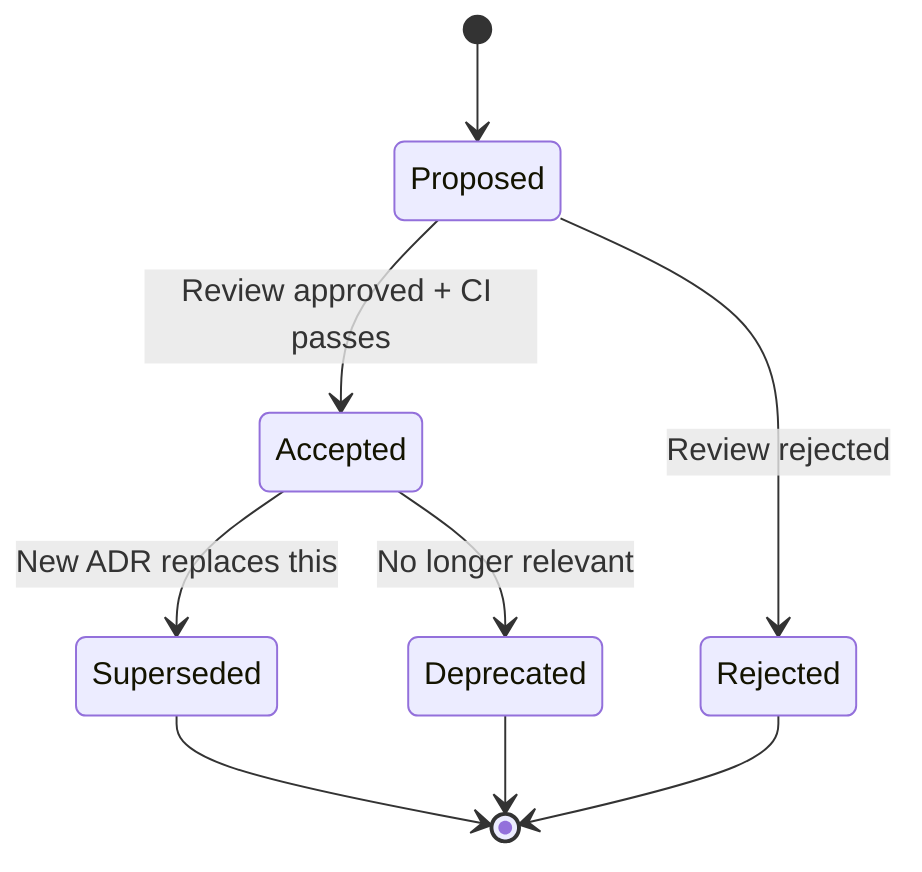

# Architecture Decision Records (ADR) Index

> This directory contains Architecture Decision Records for the SubTrackr project.
> Each ADR documents a significant architectural decision, its context, and consequences.

## ADR Template

* [Template](template.md) — Use this template for new ADRs.

## ADR List

| ID | Title | Status | Date | Authors |
|----|-------|--------|------|---------|
| 0001 | Example ADR — Replace with real title | Proposed | YYYY-MM-DD | Author Name |

---

## How to Create a New ADR

1. **Copy the template:**
   ```bash
   cp docs/adr/template.md docs/adr/0002-your-decision-title.md
   ```

2. **Fill in the template:**
   - Replace `<NNNN>` with the next sequential number (zero-padded to 4 digits)
   - Fill in all sections
   - Set initial status to `Proposed`

3. **Update this index:**
   Add a row to the table above with the new ADR.

4. **Open a PR:**
   - The CI workflow (`adr-validate.yml`) will validate the format
   - Requires review from at least one architect
   - On merge, status becomes `Accepted`

---

## ADR Status Lifecycle



---

## Validation Rules (enforced by CI)

Each ADR file must:

1. **Follow the template structure** — all required sections present
2. **Have valid front-matter** — Status, Date, Deciders fields
3. **Use valid status values** — `Proposed`, `Accepted`, `Rejected`, `Superseded`, `Deprecated`
4. **Reference valid dates** — ISO 8601 format (YYYY-MM-DD)
5. **Have sequential numbering** — no gaps in the index
6. **Be linked from this index** — every ADR in `docs/adr/` must appear in the table

---

## Tools

* **Validate locally:** `npx @adr/madr-cli validate docs/adr/`
* **Generate index:** `npx @adr/madr-cli generate-index docs/adr/ > docs/adr/README.md`

---

## Related Documentation

* [Contributing Guide](../CONTRIBUTING.md) — includes ADR process
* [Architecture Overview](../architecture.md) — high-level system design
* [CI Workflow](../../.github/workflows/adr-validate.yml) — validation rules